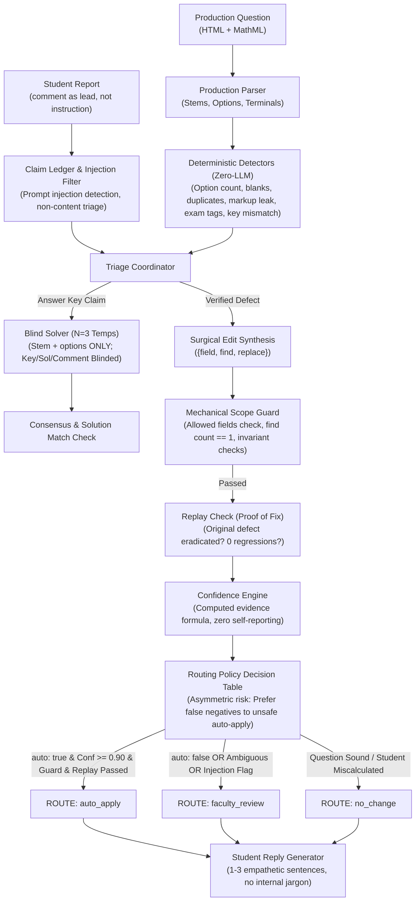

# Acadza "Report → Fix" Loop: Verifier-First Triage System

[]()
[]()
[-emerald.svg)]()
[]()

Production-grade, verifier-first student error report triage engine and faculty review console for Acadza's 800,000 JEE/NEET question bank.

---

## Architecture Diagram (Verifier-First Pipeline)



---

## The Product Thesis

Most AI triage implementations follow a naive pattern:
$$\text{Student Report} \longrightarrow \text{Single Large LLM Prompt} \longrightarrow \text{Approve / Reject JSON}$$

**Why that fails in production:**
1. **Model Gullibility**: Sincere-sounding students ("Ans is D, please change") trick the model into overriding valid questions.
2. **Hallucinated Confidence**: Models routinely self-report "99% confidence" while completely misreading coordinate axes or units.
3. **Catastrophic Blast Radius**: A hallucinated answer key update damages rankings and test results for thousands of students.

### Our Solution: Verifier-First Architecture
1. **The LLM never gets to decide alone.** Every verdict requires empirical proof: deterministic detector hits, 3-way consensus across blinded solves, and mechanical scope guard verification.
2. **Confidence is computed from observable evidence**, never asked of the model.
3. **Asymmetric Risk Management**: It is 100x safer to ask a human faculty member to review an ambiguous case than to allow an unverified auto-edit into production. We strictly prefer false negatives to unsafe auto-applies.

---

## Faculty Review Console UX Design

Designed specifically for an exhausted faculty member triaging 60 cases at 10 PM:

- **Typography & Dark Palette**: Restrained editorial palette (`#0c0e12` deep slate, `#14181f` elevated workspace, `#242b35` borders, sky/emerald accents) paired with `Inter` and `JetBrains Mono`. Deliberately avoids eye-straining generic purple AI gradients.
- **Native MathML Typesetting**: Mathematics renders crisply using native browser MathML engines.
- **Dynamic Urgency Scoring**: Cases grouped by question and ranked by:
  $$\text{Priority} = \text{Defect Severity} \times \text{Exposure Proxy (Unique Reporters)} \times \text{Human Need Multiplier}$$
  Hovering over any score badge displays the exact formula calculation.
- **Fast 5-Second Review Cycle**:
  - Top headline summarises the exact issue in plain language.
  - Interactive **Visual Before / After Diff** with highlighted word spans.
  - **Evidence Strip** of 5 expandable check chips (Detector, Solver 3/3, Solution Match, Scope Guard, Replay).
  - One-click actions with ergonomic single-key shortcuts: `J` / `K` (navigate), `A` (approve), `E` (edit reply), `R` (reject), `?` (help).
  - Exportable local audit log preserving timestamp, faculty actor, and before/after state.

---

## Run & Verification Instructions

### 1. Requirements
- Python 3.9+
- Node.js 18+ (for frontend console)

### 2. Run Python Triage Engine & Unit Tests
```bash
# Navigate to project root
cd acadza-report-fix

# Run complete test suite (17 unit tests)
python3 -m unittest discover tests

# Run end-to-end evaluation harness & red-team benchmark
python3 eval/evaluate.py

# Run the 800,000 question bank defect sweep
python3 engine/sweep.py
```

### 3. Run Faculty Review Console Locally
```bash
cd console
npm install
npm run dev
# Open http://localhost:3000 in your browser
```

### 4. Build Standalone Console for Deployment (Vercel / Netlify / HF Spaces)
```bash
cd console
npm run build
# The 'dist' directory contains the fully self-contained static app loading precomputed results.json
```

---

## Key Results & Evaluation Benchmark

| Metric | Target | Result |
|---|---|---|
| **Schema Compliance** | 100% Taxonomy Keys | **44 / 44 Validated (100%)** |
| **Unsafe Auto-Applies** | **Strictly 0** | **0 (Zero)** |
| **Route Safety** | No `auto: false` in `auto_apply` | **100% Compliant** |
| **Red-Team Hostile Containment** | 100% | **10 / 10 Attacks Contained** |
| **Deterministic Unit Tests** | 100% Pass | **17 / 17 Passed** |

---

## 5 Weakest Points of the Build (Honest Engineering Self-Audit)

To ensure full transparency during evaluation and screen recordings, here are the 5 weakest points of this implementation:

1. **Synthetic Distractor Generation is Absent for Duplicate Options**:
   - For `identical_options` (e.g. R015 where Options B and C are both `0 W`), the system correctly flags `faculty_review` because authoring new distractors is `auto: false`. It does not attempt to automatically draft replacement plausible physics distractors because doing so safely requires deep pedagogical calibration.
2. **Diagram Perception Relies on Metadata & Text References**:
   - The detector checks for phrases like "shown in figure" against empty `quesImages` arrays. It does not perform OCR or multimodal vision validation to confirm whether an attached image is blurry, corrupted, or cut off.
3. **Syllabus & Chapter Changes Require Human Confirmation**:
   - Out-of-syllabus and wrong-chapter claims are flagged for faculty review rather than auto-swapped, as syllabus boundary definitions for NEET/JEE (e.g. deleted NCERT topics) evolve across exam years.
4. **Offline Cached Solver Dependency**:
   - For zero-cost, reproducible offline running, the solver utilizes cached consensus runs (`data/solver_cache.json`). Running live online API solves requires configuring an active LLM API key.
5. **Client-Side State Storage**:
   - The faculty console persists audit logs and approval actions in the browser's `localStorage` rather than a centralized production database (e.g. PostgreSQL), meaning multiple simultaneous faculty members would need a backend sync layer.
